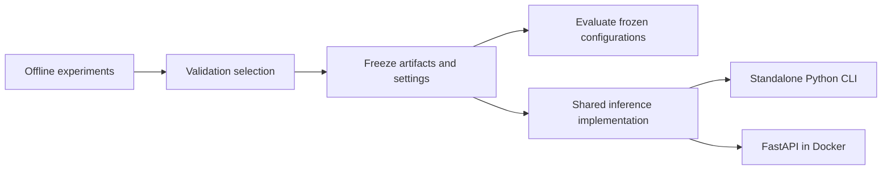

# SMS spam classification — MoneyMe assessment

Reproducible comparison of 60 local ML configurations across original data, LLM text augmentation and SMOTE, seven hosted generative LLMs, and seven hosted decision models, with an inference-only FastAPI application packaged for Docker. The always-ham baseline is separate. The [ML experiment protocol](docs/ml_experiments.md) defines treatment boundaries and search budgets; [implementation status](reports/implementation_status.md) records actual completion.

## Scope and motivation

The assessment asks for two classifiers: a supervised ML classifier and a generative LLM classifier. I also explored specialized decision models because I was curious about this recent direction in AI and wanted to compare their classification quality, latency and cost with the two required approaches.

To account for class imbalance, I used group-aware stratified splits and cross-validation, selected numeric ML configurations using spam F1, and reported spam precision/recall alongside accuracy. I searched class-weight or positive-class-weight settings where supported and selected score-based decision thresholds on validation data.

The training-data comparison evaluates original fitting data, LLM-generated spam text augmentation, and SMOTE applied to numerical feature vectors as separate treatments. Augmentation and SMOTE operate only on fitting data; validation and test messages remain unchanged. The [ML treatment report](reports/ML_TREATMENTS.md) presents their measured effects.

## Suggested reviewer flow

1. **Check the deliverables:** the [assessment checklist](docs/assessment_checklist.md) maps each requirement to its implementation and verification evidence.
2. **Review Task 1:** follow the [modelling README](task_1_modelling/README.md), open the executed [notebook](task_1_modelling/analysis.ipynb), and inspect EDA and comparisons for ML, generative LLMs and decision models. The README includes standalone prediction commands for all three.
3. **Assess the findings:** read [RESULTS.md](reports/RESULTS.md) for the selected systems, quality, latency, cost and limitations, and [ML_TREATMENTS.md](reports/ML_TREATMENTS.md) for augmentation/SMOTE comparisons. The full table is [final_comparison.csv](reports/final_comparison.csv); validation scores are separate.
4. **Run Task 2:** follow the [Docker walkthrough](task_2_deployment/README.md), test local ML, then enable the hosted LLM/decision routes with your own OpenRouter key and budget. Use the supplied sample client or interactive `/docs` to call the APIs.
5. **Inspect implementation and evidence as needed:** the [architecture](docs/architecture.md) and [experiment protocol](docs/ml_experiments.md) explain the design; [src](src/moneyme_sms_spam_classifier/), [tests](tests/), [configs](configs/) and [prompts](prompts/) contain implementation and frozen settings. Detailed records are under `artifacts/` and `reports/runs/`; [implementation status](reports/implementation_status.md) links verification evidence.

Reviewing saved results requires no training or paid inference. Serving the selected local release requires no raw dataset or GPU. Hosted predictions send SMS to OpenRouter. No experimental result should be interpreted as production accuracy on current MoneyMe traffic; the treatment comparison is explicitly exploratory because its test set had already been inspected.

## Architecture and engineering decisions



| Decision | Reason | Implementation and evidence |
|---|---|---|
| Separate experiments from serving | Requests use selected artifacts, prompts and thresholds; training never runs during inference | [Shared inference](src/moneyme_sms_spam_classifier/inference.py), [local selection](configs/local_selection.json), [hosted selection](configs/hosted_frozen.json) |
| Share CLI and API inference | Both entry points use the same feature pipeline, hosted adapters and threshold rules | [CLI](src/moneyme_sms_spam_classifier/cli.py), [API](src/moneyme_sms_spam_classifier/api.py) |
| Preserve evaluation boundaries and experiment identity | Related messages stay together, fitting operations stay within training, and saved settings/predictions make results traceable | [Task 1 design](task_1_modelling/README.md#experimental-design-and-traceability), [experiment guards](tests/test_experiment_freeze.py) |
| Use file-based experiment tracking | JSON/CSV manifests, content hashes and SQLite accounting keep evidence inspectable without a tracking server; this implementation does not use MLflow, Weights & Biases or DVC | [Tracking decision](task_1_modelling/README.md#model-versioning-and-experiment-tracking), [persistence helpers](src/moneyme_sms_spam_classifier/common.py) |
| Bound hosted spending and expose failures | Persistent cost reservations, capacity limits, provider timeouts and strict parsing make operational behavior explicit | [Task 2 design](task_2_deployment/README.md#serving-design-and-operational-controls), [hosted tests](tests/test_hosted.py), [API tests](tests/test_api.py) |
| Package the selected release reproducibly | Pinned dependencies, a checksummed artifact and non-root Docker execution support a reviewer-controlled setup | [Dockerfile](task_2_deployment/Dockerfile), [verification workflow](.github/workflows/ci.yml), [saved container checks](reports/docker_smoke.json) |
| Automate verification and deploy manually | GitHub Actions defines CI on pushes and pull requests; reviewers deploy through Docker Compose. Automated image publishing and hosted deployment are outside this assessment's scope | [CI workflow](.github/workflows/ci.yml), [CI and deployment](task_2_deployment/README.md#ci-and-deployment) |

The [architecture document](docs/architecture.md) describes the shipped components, request flow, experiment recovery and operational limits. The [repository audit](reports/repository_audit.json) records file, metric, dependency, notebook and deployment checks. The treatment evaluation shown above uses the existing already-inspected test set and remains exploratory.

## Quick start: inference

Python 3.12 is the tested target. The final local model is shipped in `artifacts/release` and requires no training or raw dataset to serve.

```bash
python -m venv .venv
source .venv/bin/activate
pip install -r requirements.txt
pip install --no-deps .
sms-spam predict --model ml --text 'Are we still meeting for lunch?'
uvicorn task_2_deployment.app:app --host 127.0.0.1 --port 8000
```

Or use Docker: [deployment instructions](task_2_deployment/README.md). The application exposes:

- `POST /predict/ml`
- `POST /predict/llm`
- `POST /predict/decision`
- `GET /health`

Prediction input: `{"text":"Your SMS"}`. Output: `{"label":"spam"}` or `{"label":"ham"}`. Open `/docs` for interactive documentation, or read [API.md](task_2_deployment/API.md). Call all enabled classifiers with `python task_2_deployment/sample_client.py`; use `--models ml` in local-only mode.

Hosted inference uses a reviewer's own OpenRouter key and requires internet access. Copy `.env.example` only if `.env` does not already exist, then edit it. Set `ENABLE_HOSTED=true` and your own positive `SERVICE_BUDGET_USD` to enable hosted APIs. Local-only mode is the default. No credentials are included in images, reports, or repository configuration.

Task 1 can also run directly as a Python program, after the installation above:

```bash
python task_1_modelling/predict.py --model ml --text 'Are we still meeting for lunch?'
# Hosted CLI calls require OPENROUTER_API_KEY in .env and authorize paid inference.
python task_1_modelling/predict.py --model llm --cap 0.05 --text 'Are we still meeting for lunch?'
python task_1_modelling/predict.py --model decision --cap 0.05 --text 'Are we still meeting for lunch?'
```

Each successful command prints `{"label": "ham"}` or `{"label": "spam"}`. The CLI's `--cap` is a cumulative USD limit for `reports/service-budget.sqlite`, separate from the experiment and Docker ledgers; preserve that file across CLI calls. CLI inference does not require the HTTP server or `ENABLE_HOSTED`; that setting controls API routes.

The [assessment deliverable checklist](docs/assessment_checklist.md) maps the guide's requirements to implementation and verification evidence.

## Experiment setup

Saved final reports and release artifacts are the submission evidence. Use a separate working copy for an independent reproduction, and archive its existing final-run directories and frozen selections before starting a new run. Training commands overwrite candidate artifacts. Reading the notebook and saved tables requires no new training or paid inference. New model development after inspecting this test set needs a new independent evaluation set.

The lockfile is the canonical resolved environment. `requirements.txt` is exported for the assessment; `requirements-analysis.txt` includes modelling/notebook tools and CUDA-enabled training dependencies. The inference installation is smaller.

```bash
uv sync --frozen --extra analysis --extra dev
# Alternatively: pip install -r requirements-analysis.txt && pip install --no-deps .
```

All commands below run from the repository root. To reproduce local experiments, acquire the data:

```bash
uv run --no-sync python scripts/download_data.py
uv run --no-sync sms-spam prepare
```

The downloader verifies the exact assessment fingerprint. If the public archive differs, obtain the original input rather than silently changing the benchmark. Dataset attribution and original terms are in [docs/DATASET_README.txt](docs/DATASET_README.txt). Raw data is ignored by Git; derived split IDs, grouping audit, fingerprints, and prepared records are persisted for review.

## Evaluation protocol

- Parse/validate the supplied tab-delimited corpus; preserve canonical SMS text.
- Remove exact duplicates; conservatively group casing/whitespace and long-message URL/number template variants.
- Approximate 60/20/20 group-aware stratified train/validation/test split; five group-aware training CV folds.
- Fit vectorizers, scalers, classifiers, and learned transformations within training folds.
- Select hyperparameters using training CV; select prompts, checkpoints, and operating thresholds on validation.
- Freeze one configuration per candidate and deployment selections before final test evaluation.
- Report spam F1, precision/recall, false positive rate, confusion counts, coverage, average precision and calibration where applicable, latency, and cost.

Spam is positive. The higher-precision operating point is exploratory, not a business SLA. Hosted failures remain failures and are never relabelled ham. The public historical dataset may overlap pretrained model training; it does not establish current production quality.

## Reproduce local modelling

The primary matrix contains **60 configurations**: 16 classical pipelines and two frozen MiniLM pipelines each compare original fitting data, Luna-generated SMS, and SMOTE; three DistilBERT settings compare original and augmented text. Every numeric configuration receives a 20-trial, five-fold randomized search with matched per-pipeline spaces across treatments. Augmentation inherits parent/family boundaries; SMOTE operates on fitting vectors only. Neither modifies validation/test messages.

```bash
uv run --no-sync python scripts/generate_augmentation.py --limit 12
# Review the source/variant pilot and its recorded quality limitations.
uv run --no-sync python scripts/generate_augmentation.py --limit 0 --rounds 2
uv run --no-sync python scripts/complete_ml_benchmark.py
```

The frozen augmentation pool is included with provenance; generation commands reuse it without new calls. A new independent reproduction needs its own run directories, explicit budget and review. The completion script verifies preservation hashes, resumes completed candidates, freezes all 60, evaluates, checks Docker, and executes the notebook. Detailed stage commands are in [docs/ml_experiments.md](docs/ml_experiments.md). Results are summarized in [reports/ML_TREATMENTS.md](reports/ML_TREATMENTS.md).

The treatment comparison uses the existing already-inspected test set and is explicitly exploratory. Its scores are not fresh independent estimates. The shipped serving artifact has a separately preserved selection/search record, reproduced by these commands:

```bash
uv run --no-sync sms-spam train --trials 20 --jobs 2
uv run --no-sync sms-spam train --trials 60 --jobs 2 --only logistic_char svm_char logistic_combined
```

Seven classical algorithms compare word counts, word/character TF-IDF, combined features, engineered SMS signals, and contextual embeddings. XGBoost accepts numerical representations, not raw strings. Every pairing's search results and validation predictions are under `artifacts/models/`; run metadata is under `reports/runs/`.

For semantic experiments, download the pretrained MiniLM and DistilBERT checkpoints using the recorded revisions in `configs/encoder_revisions.json`. The current execution cache path is machine-specific. On another machine, run `uv run --no-sync python scripts/download_models.py` to fetch those exact revisions and update only the local cache paths.

```bash
uv run --no-sync sms-spam embeddings
uv run --no-sync sms-spam encoder
uv run --no-sync sms-spam freeze-local
```

DistilBERT compares a frozen encoder with head-only training against full fine-tuning at two learning rates, over three epochs. Head-only training is not LoRA. The development machine has a 4 GB RTX 3050; CPU training is possible but slower. Large checkpoints and caches are excluded from Git; the selected release artifact is included.

Linux amd64 uses the official CPU-only XGBoost distribution. GPU work is reserved for frozen embedding extraction and DistilBERT training. Three epochs on augmented data involve more optimizer steps than three epochs on original data; matched search/epoch counts do not imply matched wall time or compute.

## Hosted experiments and spending

Model IDs are registered in `configs/candidates.json`. Seven LLMs compare zero-shot and four-example few-shot prompts; seven decision models compare `choice` and `noul`. Model relationships and changing upstream weights are documented in the plan. Availability and pricing are captured from the live catalog, then verified by actual pilot calls.

The implementation session authorizes **US$10 total, including a US$1 pilot**. Commands require explicit cumulative caps. Keep the budget ledger across stages and restarts. A reviewer rerunning these commands is authorizing charges to their own key.

```bash
uv run --no-sync sms-spam catalog
uv run --no-sync sms-spam hosted --stage pilot --limit 8 --cap 1
# The complete recorded workflow is scripts/hosted_development.py.
uv run --no-sync python scripts/hosted_development.py
```

For an interrupted run, use `python scripts/resume_hosted.py`; it resumes the current phase without reselecting models after test begins. Do not restart development selection after opening test results.

The workflow compares variants on a fixed 96-message stratified validation subset, freezes one variant per model, then evaluates those variants on full validation and selects final thresholds/champions. Selection precedes final test. Cached stage records allow interrupted runs to resume; changing a complete configuration creates a different identity. Do not edit prompts halfway through a stage.

The ledger atomically reserves a conservative request cost before sending. Unknown charges stay reserved; known charges replace reservations. No automatic retries are made initially. Review cost estimates and enforce a provider-side key limit too if available. Cached results do not measure live service latency or availability.

## Final evaluation and reports

After all selections are frozen:

```bash
uv run --no-sync sms-spam finalize
uv run --no-sync sms-spam hosted --stage test --limit 0 --cap 10 --selected
uv run --no-sync sms-spam report
uv run --no-sync python scripts/build_notebook.py
uv run --no-sync python scripts/execute_notebook.py
```

`finalize` refuses to overwrite an existing final local test evaluation. `report` reads saved predictions and regenerates basic plots/tables with no hosted calls. `python scripts/finalize_reports.py` adds the full saved-response diagnostics and executes the notebook after verification evidence is present. The notebook reads saved reports and makes no paid requests. Development spend and test spend are separate; local compute cost is unmeasured rather than falsely reported as free. Timing comparisons state concurrency, warm/cold conditions, and hardware/provider differences.

## Verification

```bash
uv run --no-sync ruff check src tests scripts task_1_modelling task_2_deployment
uv run --no-sync ruff format --check src tests scripts task_1_modelling task_2_deployment
uv run --no-sync pytest -q
uv run --no-sync python scripts/docker_smoke.py
```

CI checks lint/tests and a local-only Docker smoke test. Live hosted checks are opt-in and budgeted. Only load trusted model artifacts: joblib/pickle can execute code. Startup verifies the selected release checksum.

## Future updates

Version data, code, model artifacts, prompts, criteria, and thresholds. Monitor latency, errors, cost, changing hosted snapshots, and input/prediction shifts. Obtain representative reviewed labels to establish precision/recall or calibration degradation. Evaluate challengers before release and retain rollback artifacts. Distribution drift alone is not a reason to deploy a retrained model automatically.
