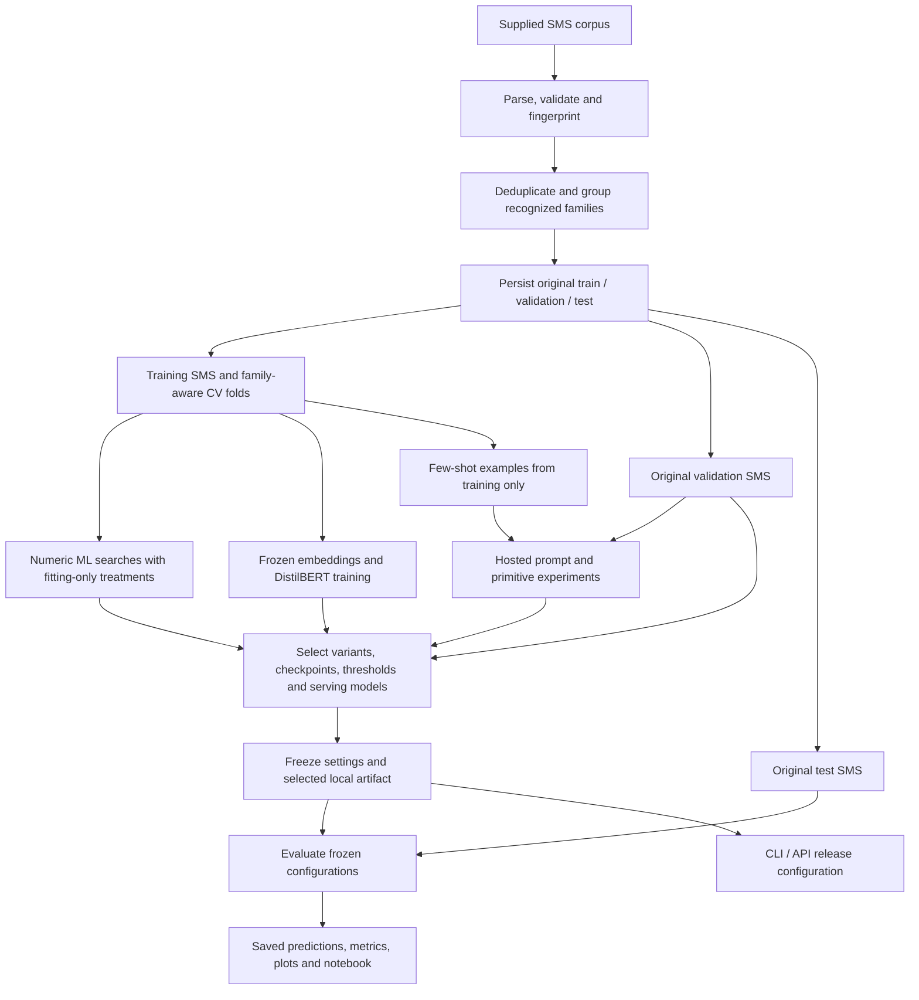
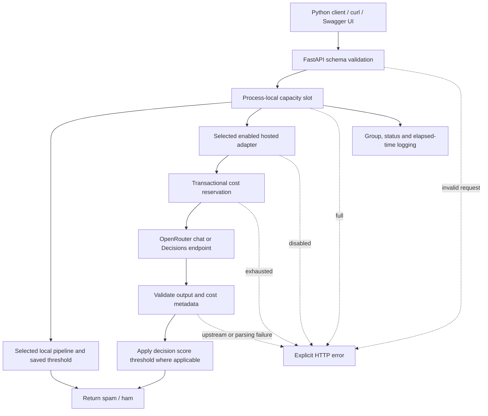

# Architecture

This document describes the implemented SMS classification system. It has an offline experiment workflow and an inference application sharing the same prediction code. Reviewers can run the selected release without training, raw data or a GPU.

## Shipped classifiers and release boundary

| Group | Selected serving configuration | Runtime dependency |
|---|---|---|
| Supervised ML | Character TF-IDF + Logistic Regression, saved validation-selected threshold | CPU and the included `artifacts/release/model.joblib` |
| Generative LLM | `google/gemini-4-hydrogen`, four-example few-shot prompt | OpenRouter key, access, internet and service budget |
| Decision model | `perplexity/pplx-decider-v1.3:free`, `choice` primitive and validation-selected threshold | OpenRouter key, access, internet and service budget |

[local_selection.json](../configs/local_selection.json) identifies the local artifact and its checksum. [hosted_frozen.json](../configs/hosted_frozen.json) identifies the hosted selections, examples and decision threshold. The saved [catalog](../reports/catalog.json) provides recorded capabilities and pricing. These are local configuration snapshots; hosted weights, availability and prices may change upstream.

The CLI and API delegate to [inference.py](../src/moneyme_sms_spam_classifier/inference.py). CLI calls do not need an HTTP server. The API loads the selected release during startup; neither interface trains models or runs augmentation/SMOTE during prediction. Candidate encoder checkpoints remain experiment artifacts and are not dependencies of the shipped local API.

## Offline experiment architecture

Training CV selects numeric ML hyperparameters. Validation selects checkpoints, hosted variants, score thresholds and serving candidates. Hosted development compares variants on a fixed 96-message validation subset before full validation. Test results do not automatically replace serving selections. The original serving freeze is preserved separately from the 60-configuration treatment evaluation.

The treatment comparison uses an already-inspected test set and is explicitly exploratory. Freezing its configurations before generating treatment predictions does not create a fresh independent evaluation. Data boundaries, search budgets and execution differences are detailed in [ml_experiments.md](ml_experiments.md).

## Fitting boundaries and imbalance strategy

The numeric matrix contains 18 pipelines, each evaluated with original data, text augmentation and SMOTE. Three DistilBERT settings compare original and augmented text, giving 60 configurations in total.

| Boundary | Implemented behavior | Purpose |
|---|---|---|
| Original partitions and training CV folds | Exact duplicates are removed; recognized family groups stay together | Reduce leakage from repeated messages/templates |
| Feature fitting | Vocabulary, IDF, scaling and other learned transformations fit within fitting partitions | Keep held-out corpus statistics out of training |
| Generated spam | Variants inherit source parent/family IDs and are eligible only when those parents are in fitting data | Keep descendants of held-out parents out of fitting |
| SMOTE | Interpolate fitting vectors after fitting the feature extractor; never resample prediction requests | Balance fitting vectors without modifying evaluation data |
| Frozen MiniLM | Compute each text's embedding with a fixed pretrained encoder | Permit caching without learning corpus statistics or labels |
| DistilBERT | Train on original or eligible augmented text and select checkpoints on validation | Keep the encoder protocol distinct from numeric CV and vector SMOTE |

Group-aware stratification and spam-specific metrics support evaluation under imbalance. Class-weight/positive-weight searches where supported, validation-selected score thresholds, and fitting-only augmentation/SMOTE address different aspects of the classification tradeoff. None is assumed to improve every candidate.

See [sampling.py](../src/moneyme_sms_spam_classifier/sampling.py), [data tests](../tests/test_data.py), [treatment boundary tests](../tests/test_sampling.py) and the [Task 1 diagram](../task_1_modelling/README.md#experimental-design-and-traceability).

## Experiment identity, persistence and recovery

Tracking is implemented with repository-visible JSON/CSV manifests and journals, content fingerprints, and SQLite cost accounting. I chose this approach to keep the assessment reviewable without an external tracking server. No MLflow, Weights & Biases or DVC integration is used; the system does not provide a centralized model registry or experiment dashboard. The [Task 1 tracking inventory](../task_1_modelling/README.md#model-versioning-and-experiment-tracking) maps versioned items to their evidence.

Hosted configuration IDs hash the model settings together with the prompt and decision criteria. Stage manifests record selected record IDs, split fingerprints, source hashes, environment information and concurrency settings. Saved configurations, journals, predictions and summaries are under `reports/runs/`; model searches and validation records are under `artifacts/`.

The runner reuses recorded outcomes and can recover settled results from the budget ledger if a journal append was interrupted. JSON metadata is written using a temporary file and atomic replacement. Journal recovery preserves an interrupted trailing fragment and rejects corruption inside completed records. Stage-resume checks reject changed records/splits; hosted test guards reject a missing full-validation freeze or changed prompt/criteria definitions before constructing a paid client.

This supports recovery, not exactly-once provider execution. A crash or timeout can leave an unresolved network attempt; its reservation remains accounted for and an explicit resume can still repeat an unrecorded request. Freezing local configuration also does not freeze a provider's underlying model weights.

Implementation: [experiments.py](../src/moneyme_sms_spam_classifier/experiments.py), [common.py](../src/moneyme_sms_spam_classifier/common.py), [augmentation.py](../src/moneyme_sms_spam_classifier/augmentation.py). Verification: [experiment guards](../tests/test_experiment_freeze.py) and [ledger/journal tests](../tests/test_hosted.py).

## Runtime request architecture

The diagram summarizes responsibilities rather than exact exception/finally ordering. The shared adapter handles cost settlement even for failed classifications. An acquired capacity slot is released when inference returns or raises a handled provider error. There is no automatic cross-model fallback or automatic retry.

Requests accept only a nonblank `text` string of at most 5,000 characters. Successful responses contain only a `spam` or `ham` label. Invalid requests return 422; disabled hosted routes, exhausted budget or capacity return 503; provider/response failures return 502; timeouts return 504. Full contracts are in [API.md](../task_2_deployment/API.md).

The API starts with hosted routes disabled. Enabling them requires configuration with the reviewer's own key and budget. CLI hosted predictions use `--cap` separately from API settings. API capacity control is process-local, and the supplied container starts one Uvicorn process. Provider connection/read timeouts do not establish a strict total request deadline.

## Cost accounting and operational visibility

Before a hosted request, the adapter estimates a conservative reservation using the saved pricing catalog. SQLite transactions serialize the check-and-reserve operation across concurrent calls sharing a ledger. Reported known charges settle the reservation; absent/invalid cost information retains the reservation. Unknown cost is never reported as zero.

| Context | Ledger | Scope |
|---|---|---|
| Experiment workflow | `reports/budget.sqlite` | Shared experiment stages using that file |
| Standalone hosted CLI | `reports/service-budget.sqlite` | Hosted CLI calls using that file |
| Docker API | `/app/runtime/service-budget.sqlite` | Both hosted routes in the persistent `service-runtime` volume |

Caps are cumulative within each ledger, not account-wide OpenRouter limits. Preserving a volume/file preserves accounting; deleting it resets local accounting. Recorded catalog prices and conservative estimates do not guarantee a provider-side spending ceiling. Runtime capacity control is not a distributed rate limiter.

Application prediction logs contain classifier group, status and elapsed milliseconds. They do not include raw SMS or API keys. `/health` reports application liveness, selected local candidate and enabled hosted groups without making a paid provider call. Model identities/settings and richer cost/usage metadata are recorded in configuration and experiment files; runtime request logs do not attach all that metadata to every request. This is application logging and saved evidence, not a deployed monitoring dashboard.

## Packaging and verification

The [Dockerfile](../task_2_deployment/Dockerfile) pins the Python base-image digest and installs pinned runtime requirements, the shared package, selected local artifact and hosted configuration. It runs as a non-root user. [Compose](../task_2_deployment/compose.yaml) binds the service to localhost and persists runtime accounting. No training dataset, full encoder checkpoint, GPU or model download is required at startup. Hosted inference still needs outbound internet access.

Local model loading checks the SHA-256 recorded in the selection file. This detects a mismatched artifact; it is not a signature or permission to load an untrusted pickle/joblib file. The included model must be treated as a trusted repository release artifact.

The [CI workflow](../.github/workflows/ci.yml) defines GitHub Actions checks on pushes and pull requests: install locked dependencies, check lint/formatting, run automated tests, then build and smoke-test the local-only Docker service. CI makes no paid provider calls. GitHub execution requires the workflow to be committed and pushed; the saved reports below document local verification, not a completed GitHub Actions run.

Deployment is manual through Docker Compose. The repository has no automated image publishing or hosted deployment, so it provides configured continuous integration and reproducible manual deployment rather than a continuous deployment pipeline. See [CI and deployment](../task_2_deployment/README.md#ci-and-deployment) for the reviewer-facing explanation.

[Unit tests](../tests/) cover data/treatment boundaries, parsing, budget concurrency/recovery, freeze guards and API contracts. Saved execution evidence includes [local Docker checks](../reports/docker_smoke.json), a [Git-visible-files deployment rehearsal](../reports/clean_checkout_smoke.json), and a [budgeted live hosted check](../reports/live_container_smoke.json). These reports identify the tested images and scope; the Git-visible rehearsal was a working-tree mirror, not a committed-clone check.

Reviewer commands: [Task 1](../task_1_modelling/README.md), [Task 2](../task_2_deployment/README.md). Overall deliverable mapping: [assessment_checklist.md](assessment_checklist.md). Actual experiment completion and verification evidence: [implementation_status.md](../reports/implementation_status.md). The [repository audit](../reports/repository_audit.json) records the subsequent documentation, source, saved-metric, notebook and deployment review.
