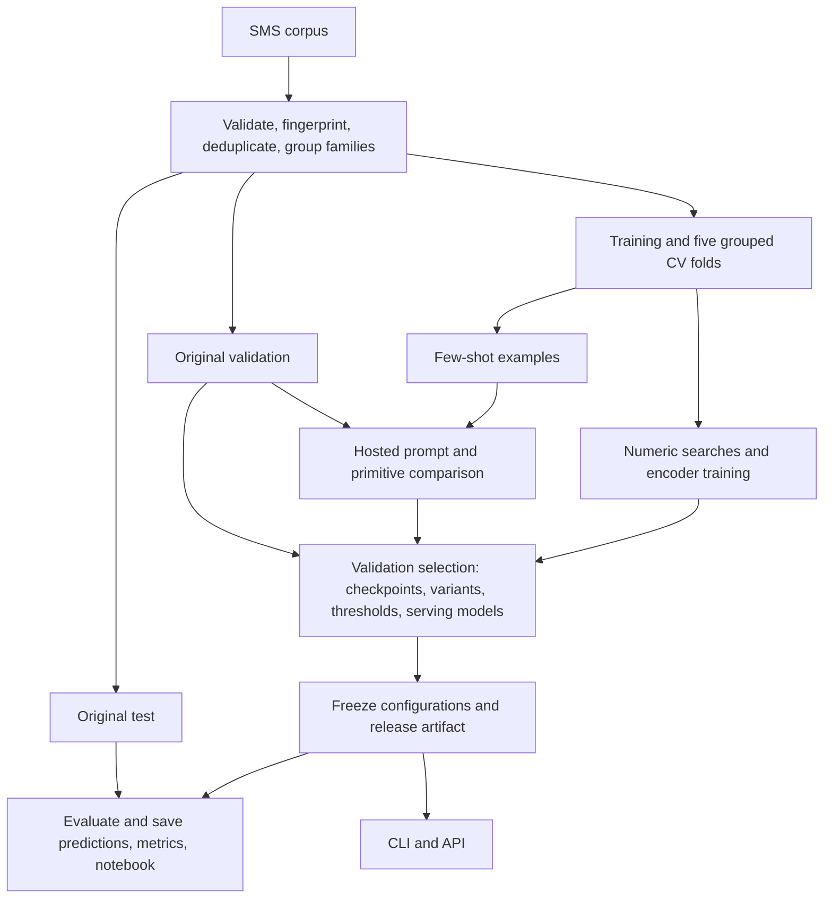
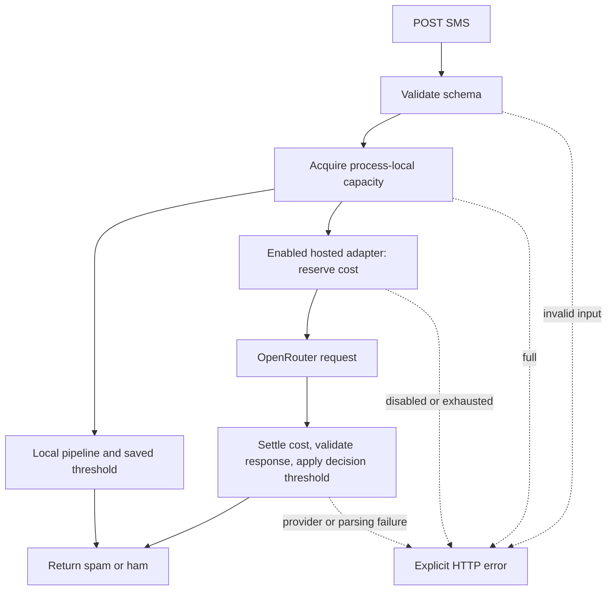

# Architecture

Offline experiments produce frozen release settings. The CLI and API share [inference.py](../src/moneyme_sms_spam_classifier/inference.py); neither trains or resamples during prediction.

## Release

| Group | Serving configuration | Runtime |
|---|---|---|
| ML | Character TF-IDF + Logistic Regression and validation-selected threshold | CPU; included artifact |
| LLM | `google/gemini-4-hydrogen`, four-example few-shot | OpenRouter |
| Decision | `perplexity/pplx-decider-v1.3:free`, `choice` and selected threshold | OpenRouter |

[Local selection](../configs/local_selection.json) records the artifact checksum; [hosted selection](../configs/hosted_frozen.json) records models, examples, and thresholds. The [catalog](../reports/catalog.json) snapshots pricing/capabilities. Hosted weights, routing, availability, and prices can change behind stable IDs.

## Experiment flow

Numeric hyperparameters use training CV. Hosted variants first use a fixed 96-message validation subset, then full validation. Related message families stay together; learned features, augmentation, and SMOTE stay within fitting partitions. Frozen MiniLM embeddings can be cached because the encoder learns no corpus statistics. DistilBERT uses a separate checkpoint-selection protocol.

The 60-configuration treatment comparison reuses an already-inspected test set and is exploratory. Serving selections retain their original freeze records. See the [experiment protocol](ml_experiments.md) for exact boundaries, budgets, and hardware differences.

## Versioning and recovery

File-based tracking keeps experiments inspectable without an external server; MLflow, Weights & Biases, and DVC are not used.

| Item | Evidence |
|---|---|
| Code/environment | Git revision/status, source hashes, environment metadata, lockfile |
| Data | Raw/prepared fingerprints, family IDs, split IDs, seeds, CV folds |
| Local models | Search histories, hyperparameters, thresholds, predictions, artifact checksum |
| Encoders | Exact revisions in [encoder_revisions.json](../configs/encoder_revisions.json) |
| Hosted configurations | Model/settings/examples/criteria; identities include prompt and criteria content |
| Outcomes/cost | JSON/CSV manifests, request journals, SQLite reservations and known charges |

Records live in `artifacts/` and `reports/runs/`. Atomic metadata writes and journal/ledger recovery reuse completed outcomes. Resume guards reject changed records, splits, prompts, or criteria. Historical manifests retain their actual source identity.

Recovery does not guarantee exactly-once provider execution: unresolved network attempts retain reservations and may be repeated on explicit resume. This is file-based tracking, not a centralized registry. Implementations: [common.py](../src/moneyme_sms_spam_classifier/common.py), [experiments.py](../src/moneyme_sms_spam_classifier/experiments.py), and [augmentation.py](../src/moneyme_sms_spam_classifier/augmentation.py).

## Request flow

Successful responses contain only a label. Failures are explicit, with no automatic retry or fallback; capacity slots are released after completion/errors. See [API.md](../task_2_deployment/API.md) for schemas and status codes. CLI prediction bypasses HTTP but uses the same adapters and thresholds.

SQLite transactions serialize cost checks/reservations. Known charges settle reservations; unknown charges remain reserved, including after failed classifications.

| Context | Persistent ledger |
|---|---|
| Experiments | `reports/budget.sqlite` |
| Hosted CLI | `reports/service-budget.sqlite` |
| Docker API, both hosted routes | `/app/runtime/service-budget.sqlite` in `service-runtime` |

Caps apply per ledger, not account-wide. Deleting a ledger resets accounting. `MAX_INFLIGHT` is per process; the container starts one Uvicorn process. Provider timeouts are not a strict total request deadline. Logs contain group/status/elapsed time, without SMS or keys. Health checks application liveness, not provider availability.

## Packaging and operations

The [Dockerfile](../task_2_deployment/Dockerfile) pins Python/dependencies, includes the selected artifact/configurations, and runs as non-root. [Compose](../task_2_deployment/compose.yaml) binds localhost and persists accounting. No dataset, GPU, or model download is needed for local serving. Startup verifies the artifact checksum; load only trusted joblib artifacts.

[CI](../.github/workflows/ci.yml) defines lint, formatting, tests, and local-only Docker verification without paid calls. Deployment is manual. Saved [Docker](../reports/docker_smoke.json), [committed-checkout](../reports/committed_checkout_smoke.json), and [live hosted](../reports/live_container_smoke.json) checks document their own tested revisions/images; they do not establish a completed GitHub Actions run.

Production work includes authentication/TLS, representative labelled traffic, load tests, quality/latency/cost monitoring, challenger evaluation, and rollback. Distribution drift alone does not establish accuracy loss.
