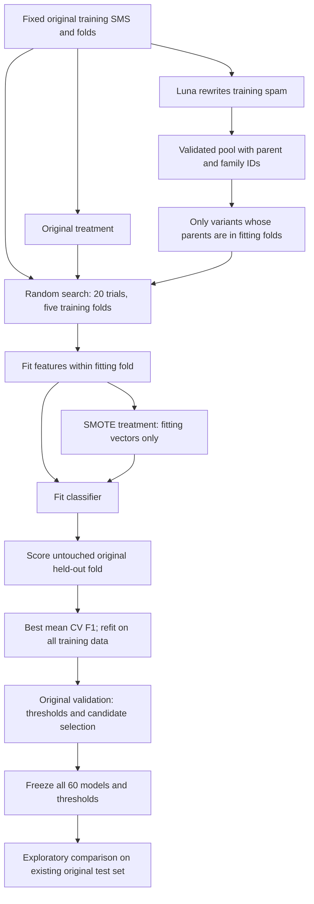

# ML experiment protocol

The local benchmark contains 60 configurations: 16 classical pipelines and two frozen-embedding pipelines each compare original data, LLM text augmentation, and SMOTE; three DistilBERT configurations each compare original and augmented text. The always-ham baseline is separate. Hosted LLM and decision-classifier experiments use their own frozen configurations.

## Data boundaries

The original prepared records, family assignments, train/validation/test partitions, and five training CV folds are fixed. Training contains 2,710 ham and 392 spam. Validation contains 1,035 original SMS; test contains 1,034 original SMS. Neither evaluation partition is augmented or resampled.



## Treatment definitions

| Treatment | Fitting data | Prediction data |
|---|---|---|
| `original` | Original fitting SMS only | Original messages |
| `text_aug` | Original fitting SMS plus descendants of eligible fitting parents | Original messages |
| `smote` | Original fitting SMS transformed into vectors, then minority-vector interpolation | Original messages |

Augmentation and SMOTE are separate arms; there is no combined arm. Both balance the fitting partition to equal ham/spam counts. Full-training augmentation selects 2,318 accepted generated examples; CV rounds have their own quotas. Extra cached variants provide coverage and replacements, not extra evaluation support.

Parent IDs and family IDs are inherited by generated variants. Round-robin parent selection limits domination by prolific generators. A generated variant cannot be used when its parent's family is held out. Vectorizers learn vocabulary and IDF from the fitting text only. SMOTE runs after fitting/transforming that fold's original text and before fitting its classifier. Synthetic vectors are never passed through a text tokenizer.

MiniLM is frozen at its recorded revision. Its independently computed embeddings can be cached across folds because the encoder is not fitted on corpus statistics or labels. SMOTE interpolates those fixed vectors. DistilBERT compares head-only training at 0.001 and full fine-tuning at 0.00002 and 0.00005, three epochs each, selecting validation checkpoints followed by thresholds. Ordinary SMOTE does not apply to its token sequences.

## Search and weighting

Each of the 54 numeric configurations receives a 20-trial randomized search with five fixed group-aware training folds, the same seed, and the same per-pipeline search space across treatments. This gives up to 5,400 CV fits plus final refits. Search uses default classifier decision rules; subsequent threshold selection uses validation. Search spaces may contain fewer effective combinations or sampled duplicates; saved histories are authoritative.

Class-weight choices remain explicit hyperparameters. `balanced` recomputes weights from the effective fitting labels; on balanced resampled data it gives equal class weights. Fixed spam multipliers can still increase spam influence. Reports record fitted class counts and selected settings. There is no assumption that balancing improves F1 or probability calibration.

The inference artifacts contain feature extraction and the fitted classifier, not augmentation or SMOTE operations. Prediction never generates training data or resamples requests.

## Generation and quality

Generator: `openai/gpt-6-luna`; prompt: `prompts/spam_augmentation_v1.txt`; settings: `configs/imbalance_experiment.json`. Generation uses the shared persistent US$10 ledger and existing remaining authorization. Requests are cached by prompt/configuration and parent identity; interruption recovery uses settled ledger metadata and journals.

The generator rewrites one original training spam at a time. It receives no validation/test messages, predictions, or labels. Automated checks reject empty/oversized outputs, duplicate text, matches to another original training family template, and invented long digit sequences or URLs. These checks cannot establish semantic label validity. Assistant qualitative pilot review is recorded separately and is not independent human annotation. Ambiguous source labels, semantic drift, and generator-style shortcuts remain limitations. The generated spam label is inherited, not independently verified.

Saved pool records contain generated text, parent/family IDs, source fold, generator/configuration identity and attempt ID. The pool is frozen before augmentation training and its hash is checked on resume. Generation costs are separate from classifier inference costs and are not multiplied by the number of trials or folds.

## Execution

```bash
uv sync --frozen --extra analysis --extra dev
python scripts/generate_augmentation.py --limit 12
# Review reports/runs/augmentation/pilot_review.json and source/variant examples.
python scripts/generate_augmentation.py --limit 0 --rounds 2
python scripts/run_imbalance.py embeddings
python scripts/run_imbalance.py numeric
python scripts/run_imbalance.py encoders
python scripts/run_imbalance.py freeze
python scripts/run_imbalance.py evaluate
```

The generation commands make paid calls within the cumulative cap; training/evaluation make no classifier API calls. Numeric fitting can resume by completed candidate; `--treatments` and `--only` restrict work. Large checkpoints and vector caches are ignored by Git; configurations, search histories, predictions, manifests and generated-text provenance are reviewable.

The supplied frozen pool contains 2,550 accepted variants, covering the full-training and all five CV fitting quotas. Its frozen identity makes generation commands return the cached summary without paid calls. An independent regeneration can differ because provider generation is not deterministic; the persisted pool, request journal and fingerprints are the exact execution evidence. `augmentation_fit_membership.json` records which generated IDs and parent IDs enter each fitting partition. `search_budget_audit.json` verifies matched sampled settings and complete finite fold scores across treatments.

Linux amd64 uses XGBoost's official CPU-only package, keeping CPU searches independent of GPU-driver discovery. CUDA is used for frozen embedding extraction and encoder training. Training runs can overlap; wall times are operational measurements, not isolated hardware benchmarks. Original and augmented encoder runs match epoch counts, so augmented runs take more optimizer steps. A recovered completed checkpoint can have unknown training wall time; missing time is never reported as zero.

Encoder execution is recorded in `configs/encoder_runtime.json` and per-model manifests. Head-only and 0.00002 full fine-tuning use CUDA with float16 autocast. The 0.00005 full-fine-tuning pair uses CPU float32 for both original and augmented data because of recurring WSL GPU-driver waits. Its CPU execution uses dynamic padding, six CPU threads and seeded length-grouped batches to reduce padding overhead while retaining the 128-token cap, batch size, accumulation and epoch budgets. Comparisons within each encoder setting use matched backend, precision and batching. Comparisons across settings include these execution differences and do not isolate learning rate alone.

An isolated official CPU-only PyTorch runtime avoids optimizer-level CUDA probes when WSL's driver is unresponsive. It does not replace the main environment. After installing the locked analysis environment, prepare it with `uv pip install --target .cache/cpu_torch --no-deps -r requirements-encoder-cpu.txt`. Run a CPU recovery with `python scripts/cpu_runtime.py scripts/complete_ml_benchmark.py`. The supplied runtime is pinned separately and its actual version/build is recorded in per-model manifests. GPU settings should be trained in the primary CUDA-capable environment when reproducing the recorded mixed-backend execution from scratch.

Text augmentation also introduces information from a pretrained generator, unlike SMOTE's interpolation of supplied vectors. The comparison evaluates these complete strategies; it does not isolate sample count from generator knowledge or establish that Luna is the optimal augmentation model.

## Evaluation provenance and deployment

The existing test results have already been inspected. Its unchanged messages are used for an explicitly exploratory treatment comparison; this is not a new independent generalization estimate. A fresh temporal or representative external holdout is required for a fresh final claim. Freeze candidate definitions before computing these comparisons and do not tune on their errors.

The API's existing release artifact and hosted selections remain separately frozen. The release decision is not automatically changed by a treatment ranking. Historical preselected-system evidence and equal-budget treatment evidence are distinguished by manifests and evaluation-scope fields. Actual completion and verification status are in `reports/implementation_status.md`.

Neural classification metrics are computed with batched CPU inference using six threads for efficiency. Warm end-to-end per-message latency uses one thread, concurrency one, and 100 original test messages, including encoding. These scopes are recorded separately; bulk scoring time is not presented as single-request latency. Classical pipeline latency also uses one-thread settings. Hosted latency includes network/provider time and was measured at its recorded concurrency.
