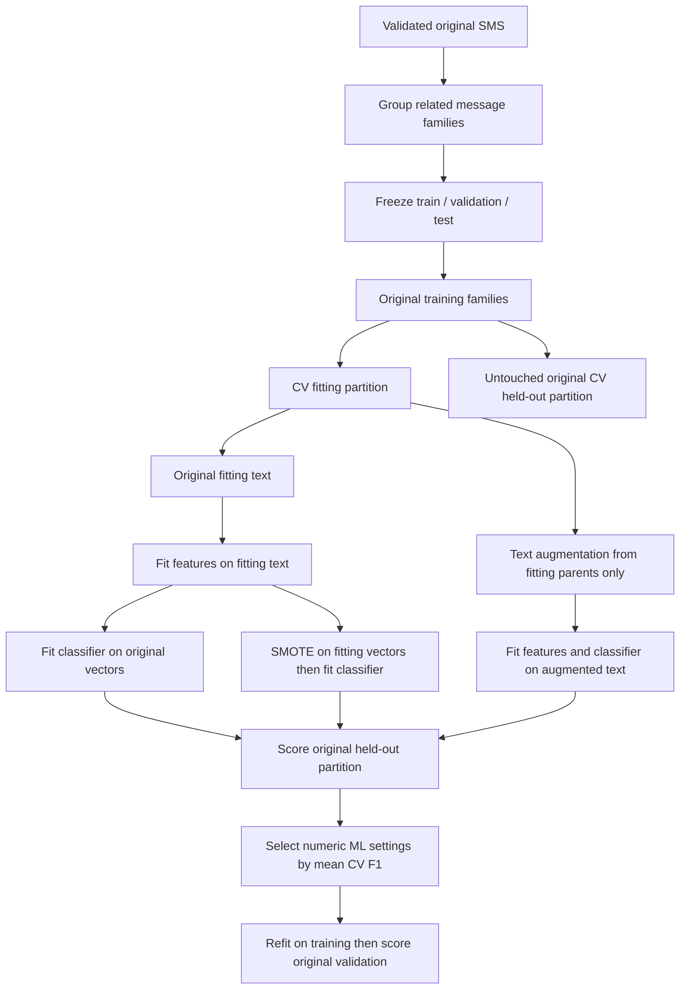

# Task 1: modelling and standalone classification

This task compares three approaches to SMS spam classification: supervised ML, generative LLMs, and specialized decision models. Every classifier returns `spam` or `ham`; spam is the positive class.

The assessment requires the ML and generative LLM classifiers. I also evaluated decision models out of curiosity about this recent direction in AI and its quality, latency and cost tradeoffs.

The imbalance strategy includes group-aware stratified splits and cross-validation, spam-F1-based numeric ML selection, precision/recall reporting, class-weight or positive-class-weight searches where supported, and validation-selected score thresholds. The ML experiments also compare original training data, LLM-generated spam text augmentation, and SMOTE on numerical features as separate treatments; validation and test messages remain unchanged.

For a quick review, open the executed [analysis notebook](analysis.ipynb), read the [results](../reports/RESULTS.md), then run the prediction examples below. Saved notebook outputs and reports require no API key, training, or GPU. Run every command in this README **from the repository root**, not from `task_1_modelling/`.

## What to review

| File | Purpose |
|---|---|
| [analysis.ipynb](analysis.ipynb) | Dataset statistics, class imbalance, length distributions, embedding visualizations, and model comparisons across all three groups |
| [predict.py](predict.py) | Standalone Python prediction program; choose `ml`, `llm`, or `decision` |
| [prepare_data.py](prepare_data.py) | Dataset parsing, validation, deduplication, family grouping and frozen partitions |
| [train.py](train.py) | Classical ML training/search entry point; the full treatment and encoder workflows are documented separately |
| [evaluate.py](evaluate.py) | Finalize the selected local models' held-out evaluation; protects an existing final evaluation from overwrite |
| [Shared Python package](../src/moneyme_sms_spam_classifier/) | Reusable implementations used by the standalone scripts and Task 2 API |

The notebook presents precision, recall, accuracy, spam F1, confusion counts, coverage, latency and cost, with separate group comparisons and ML treatment comparisons. The full saved table is [final_comparison.csv](../reports/final_comparison.csv); the ML treatment analysis is [ML_TREATMENTS.md](../reports/ML_TREATMENTS.md).

## Experimental design and traceability



The diagram describes numeric ML tuning. Frozen MiniLM embeddings are independently computed with a fixed pretrained encoder; no corpus vocabulary or label fitting occurs in that encoder. DistilBERT follows its separate training/checkpoint protocol rather than numeric randomized CV. Neither augmentation nor SMOTE changes held-out CV, validation or test messages.

| Decision | Reason | Implementation and evidence |
|---|---|---|
| Keep message families together | Exact duplicates and recognized templates should not inflate evaluation by appearing in different partitions or training CV folds | [Data preparation](../src/moneyme_sms_spam_classifier/data.py), [data tests](../tests/test_data.py), [split manifest](../artifacts/splits/manifest.json) |
| Apply treatments within fitting partitions | Generated descendants are eligible only when their parents are in fitting data; SMOTE runs after fitting that partition's feature extractor | [Treatment implementation](../src/moneyme_sms_spam_classifier/sampling.py), [boundary tests](../tests/test_sampling.py) |
| Freeze selection before evaluation | Training CV selects numeric settings; validation selects thresholds, prompts and checkpoints; configuration guards reject changed hosted definitions when resuming test | [Experiment guards](../tests/test_experiment_freeze.py), [protocol](../docs/ml_experiments.md) |
| Persist identities, manifests and journals | Configuration hashes include prompts/criteria; manifests record data/source identities; request records support inspection and recovery of completed work | [Experiment runner](../src/moneyme_sms_spam_classifier/experiments.py), [persistence helpers](../src/moneyme_sms_spam_classifier/common.py), [saved runs](../reports/runs/) |

Hosted recovery reuses recorded outcomes and can recover settled results from the ledger when a journal append was interrupted. This reduces repeated work; an interrupted network request does not have an exactly-once execution guarantee. Unknown charges remain reserved. The hosted tests exercise journal and ledger recovery. Stable hosted model IDs also do not guarantee immutable upstream weights.

The serving selections retain their original freeze records. The 60-configuration treatment evaluation is explicitly exploratory because the existing test set had already been inspected; freezing treatment settings does not turn it into a new independent holdout.

## Model versioning and experiment tracking

I chose lightweight file-based tracking so reviewers can inspect the experiment evidence directly from the repository without operating an external tracking service. The implementation uses JSON/CSV records, SHA-256 fingerprints and SQLite accounting rather than MLflow, Weights & Biases or DVC.

| Tracked item | Recorded evidence |
|---|---|
| Code and environment | Git commit and working-tree status, source hashes and environment metadata in run manifests; dependency pins in the lockfile |
| Data and evaluation boundaries | Raw/prepared fingerprints, split IDs, family groups, seeds and training CV folds |
| Local models | Hyperparameters, search histories, predictions, selected thresholds and the deployed artifact checksum |
| Pretrained encoders | Exact Hugging Face revision IDs in [encoder_revisions.json](../configs/encoder_revisions.json) |
| Hosted models and prompts | Model IDs, settings, examples, criteria and thresholds; configuration IDs hash model settings together with prompt/criteria content |
| Outcomes and spending | Saved run summaries/request journals and a persistent SQLite ledger with reservations and known charges |

The [local release selection](../configs/local_selection.json) and [hosted selections](../configs/hosted_frozen.json) identify what the CLI/API serve. Startup verifies the local artifact checksum. Completed experiment outcomes can be reused during recovery, and hosted test guards reject changed prompt/criteria definitions.

This approach provides repository-based traceability and recovery, not a centralized experiment dashboard or model registry. Hosted model IDs cannot pin upstream weights. Historical manifests retain the actual Git commit, dirty status and source hashes from execution; they are not rewritten to imply that later commits existed during training. The persistence and identity implementations are in [common.py](../src/moneyme_sms_spam_classifier/common.py) and [experiments.py](../src/moneyme_sms_spam_classifier/experiments.py).

## Install for standalone predictions

Use Python **3.12**, the tested version. The project supports Python 3.12–3.13. The selected ML artifact is included, so inference requires neither raw training data nor model training.

Linux, macOS or WSL:

```bash
python3.12 -m venv .venv
source .venv/bin/activate
python -m pip install -r requirements.txt
python -m pip install --no-deps .
```

Windows PowerShell, without needing to activate the environment:

```powershell
py -3.12 -m venv .venv
.venv\Scripts\python.exe -m pip install -r requirements.txt
.venv\Scripts\python.exe -m pip install --no-deps .
```

For the commands below, Windows users can replace `python` with `.venv\Scripts\python.exe`. For an environment with Docker and no host Python, use the [Task 2 instructions](../task_2_deployment/README.md).

## Run the three classifiers

These are the serving configurations selected using validation data before the original final test evaluation. The CLI and API share the same inference implementation and frozen selections.

| CLI selector | Selected classifier | Where inference runs |
|---|---|---|
| `ml` | Character TF-IDF + Logistic Regression | Locally, on CPU |
| `llm` | `google/gemini-4-hydrogen`, four-example few-shot prompt | OpenRouter |
| `decision` | `perplexity/pplx-decider-v1.3:free`, `choice` primitive and validation-selected threshold | OpenRouter |

### Local supervised ML

```bash
python task_1_modelling/predict.py --model ml --text 'Are we still meeting for lunch?'
```

This transforms the text with the saved feature pipeline, scores it with the fitted classifier, applies the saved threshold, and prints a label. No API key or network request is needed for this prediction.

### Hosted generative LLM and decision model

Create `.env` by copying the root [.env.example](../.env.example) **only if `.env` does not already exist**, then set your own key:

```dotenv
OPENROUTER_API_KEY=replace_with_your_own_key
```

Run either classifier:

```bash
python task_1_modelling/predict.py --model llm --cap 0.05 --text 'Are we still meeting for lunch?'
python task_1_modelling/predict.py --model decision --cap 0.05 --text 'Are we still meeting for lunch?'
```

These commands send the SMS to OpenRouter. The generative LLM classifies using a prompt and labelled examples. The decision model uses structured alternatives, produces a spam score, and applies its frozen threshold. Its prompt/criteria and selected primitive are handled by the shared adapter; reviewers supply only the SMS.

`--cap 0.05` authorizes a **US$0.05 cumulative limit** for the CLI's `reports/service-budget.sqlite` ledger, shared by both hosted CLI classifiers. It is not a per-request allowance. Conservative reservations can stop calls before billed usage reaches the limit. Preserve the ledger across invocations. The experiment ledger and Docker service ledger are separate; this setting is not an account-wide OpenRouter cap. Hosted availability and pricing can change, including for a model whose ID contains `:free`.

The CLI reads `OPENROUTER_API_KEY` from the environment or `.env`. It uses `--cap` for spending control; **`ENABLE_HOSTED` and `SERVICE_BUDGET_USD` configure the API, not these CLI commands**. No HTTP server needs to be running.

Each successful command prints JSON, for example:

```json
{"label": "ham"}
```

The only possible successful labels are `ham` and `spam`. Blank inputs and messages longer than 5,000 characters are rejected. Hosted failures fail the command rather than silently becoming ham. Show CLI options with:

```bash
python task_1_modelling/predict.py --help
```

## Understand or reproduce the experiments

The comparison covers 60 local ML configurations: 21 original-data, 21 text-augmentation and 18 SMOTE configurations. It also covers seven generative LLMs, each developed with zero-shot/few-shot variants, and seven decision models, each developed with `choice`/`noul` variants. One variant per hosted model proceeds to the final comparison. An always-ham baseline is reported separately.

The data flow is:

```text
Supplied SMS -> validate/deduplicate/group related messages -> frozen partitions
  Training   -> five grouped CV folds -> hyperparameter search for numeric ML
             -> encoder fitting (original or fitting-only augmented text)
             -> fitting-only augmentation or SMOTE for numeric ML treatments
  Validation -> thresholds, hosted variants, encoder checkpoints and serving selections
  Test       -> evaluation of frozen configurations -> tables, plots and notebook
```

Validation and test messages are never augmented or resampled. The ML treatment comparison uses an already-inspected test set and is explicitly exploratory; see the [experiment protocol](../docs/ml_experiments.md) for the precise evaluation boundaries and search budgets. The [architecture](../docs/architecture.md) describes the shared components. Model and prompt selections are stored in [local_selection.json](../configs/local_selection.json) and [hosted_frozen.json](../configs/hosted_frozen.json); implementation and prompts are in the shared package and [prompts directory](../prompts/).

For full training, data acquisition, exact pretrained revisions, generation, budgeted hosted experiments and report regeneration, follow the root [experiment setup](../README.md#experiment-setup) and [ML protocol](../docs/ml_experiments.md#execution). Use a separate working copy for reproduction because training writes artifacts; serving the supplied release needs none of those steps.

The notebook already contains its outputs and can be viewed on GitHub or in a notebook editor. To execute it again from the saved reports, install the locked analysis environment and run:

```bash
uv sync --frozen --extra analysis --extra dev
uv run --no-sync python scripts/execute_notebook.py
```

This reexecutes the notebook without training or paid API calls. The analysis environment is larger than the inference environment and includes deep-learning dependencies.
