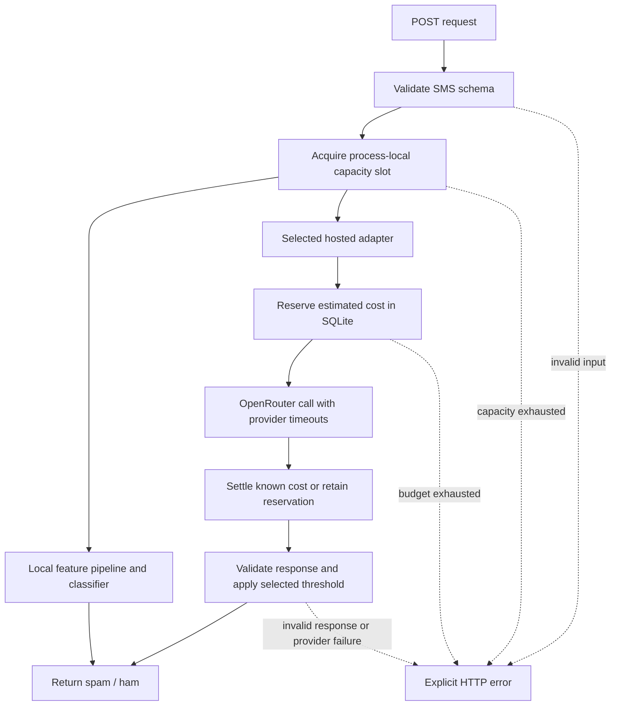

# Task 2: run and test the classification API

This Docker application exposes the selected **ML, generative LLM, and decision classifiers** through three inference endpoints. Reviewers can build and run it on their own machines; no public deployment is required. All successful prediction responses contain `{"label":"spam"}` or `{"label":"ham"}`.

## Prerequisites

- A copy of the submitted repository, with commands run **from its root directory**.
- Docker Desktop, or Docker Engine with the Compose plugin. `docker version` must show both Client and Server; `docker compose version` must succeed. For WSL, enable Docker Desktop → Settings → Resources → WSL Integration for your distribution.
- Internet access for the initial image build. To call the hosted classifiers, also provide your own OpenRouter key, credits/access to the selected models, and outbound HTTPS access at runtime.

No host Python installation, GPU, raw dataset or training run is needed for this walkthrough. The selected local artifact is included and its checksum is verified at startup. The tested target is Linux amd64; Compose selects that platform. ARM machines need Docker's amd64 emulation and may have different performance.

## 1. Create the environment file

Copy the root [.env.example](../.env.example) to `.env` if the file does not already exist. Preserve an existing file and edit its settings instead.

Linux, macOS or WSL:

```bash
if [ ! -f .env ]; then
  cp .env.example .env
fi
```

Windows PowerShell:

```powershell
if (-not (Test-Path .env)) { Copy-Item .env.example .env }
```

Choose either mode by editing `.env` in a text editor:

| Setting | Local ML only | All three classifiers |
|---|---|---|
| `ENABLE_HOSTED` | `false` | `true` |
| `OPENROUTER_API_KEY` | Leave blank | Your own key |
| `SERVICE_BUDGET_USD` | `0` | A positive cumulative USD cap you authorize |
| `MAX_INFLIGHT` | `4` | `4` |

For an all-three-classifier review with a US$0.10 service limit, for example:

```dotenv
OPENROUTER_API_KEY=replace_with_your_own_key
ENABLE_HOSTED=true
SERVICE_BUDGET_USD=0.10
MAX_INFLIGHT=4
```

`ENABLE_HOSTED` means **allow this API to call the remote models through OpenRouter**. With `false`, ML works locally while `/predict/llm` and `/predict/decision` return HTTP 503. With `true`, those two routes use the supplied key and the shared service budget. It does not train or download models, and it does not publish your API to the internet.

The service limit is cumulative across both hosted routes and restarts, not a fresh allowance per call. The example cap is for a small review, not the full benchmark. Requests reserve a conservative estimated cost, so the service may refuse a request before actual billed spend reaches the cap. The runtime ledger lives in a persistent Docker volume; it is separate from CLI and experiment accounting and is not an account-wide provider limit. Keep `.env` private.

## 2. Build and start

The same commands work in a POSIX terminal or PowerShell:

```bash
docker compose --env-file .env -f task_2_deployment/compose.yaml up --build -d
docker compose --env-file .env -f task_2_deployment/compose.yaml ps
```

The first build downloads dependencies. Wait for the service to become healthy, then open:

- Health: [http://localhost:8000/health](http://localhost:8000/health)
- Interactive API documentation: [http://localhost:8000/docs](http://localhost:8000/docs)
- OpenAPI schema: [http://localhost:8000/openapi.json](http://localhost:8000/openapi.json)

`/health` returns `status: "ok"`, the selected local model and `hosted_enabled`. The latter is `[]` in local-only mode and `["decision", "llm"]` when enabled. Health makes no provider call; it confirms the app has started, not OpenRouter availability.

After editing `.env`, apply the new settings with:

```bash
docker compose --env-file .env -f task_2_deployment/compose.yaml up -d --force-recreate
```

Shell environment variables override matching values in Compose's `.env` file. If settings seem unchanged, check for previously exported variables before recreating the service.

## 3. Test using the supplied Python client

Run the client **inside the container**, using its installed Python and dependencies. This calls the running HTTP API and prints each model name, HTTP status and JSON response.

Local-only mode:

```bash
docker compose --env-file .env -f task_2_deployment/compose.yaml exec classifier python task_2_deployment/sample_client.py --base-url http://127.0.0.1:8000 --models ml
```

All three classifiers, after enabling hosted mode:

```bash
docker compose --env-file .env -f task_2_deployment/compose.yaml exec classifier python task_2_deployment/sample_client.py --base-url http://127.0.0.1:8000
```

To supply your own SMS or test just the decision model:

```bash
docker compose --env-file .env -f task_2_deployment/compose.yaml exec classifier python task_2_deployment/sample_client.py --base-url http://127.0.0.1:8000 --models decision --text "Your SMS here"
```

Successful output has this shape; predicted labels depend on the text and model:

```text
ml 200 {'label': 'spam'}
llm 200 {'label': 'spam'}
decision 200 {'label': 'spam'}
```

The client exits nonzero if any requested endpoint returns an HTTP error. Omitting `--models` requests all three; local-only mode intentionally fails the two hosted requests. To run the same client from host Python instead, install the root [requirements.txt](../requirements.txt), then use `python task_2_deployment/sample_client.py --models ml` or omit `--models ml` for all three.

## 4. Test individual endpoints

| Endpoint | Selected classifier |
|---|---|
| `POST /predict/ml` | Character TF-IDF + Logistic Regression, running on CPU |
| `POST /predict/llm` | `google/gemini-4-hydrogen`, few-shot, through OpenRouter |
| `POST /predict/decision` | `perplexity/pplx-decider-v1.3:free`, `choice` and a frozen threshold, through OpenRouter |

All accept the same JSON body:

```json
{"text":"Are we still meeting for lunch?"}
```

In `/docs`, expand an endpoint, choose **Try it out**, enter the JSON and choose **Execute**. For curl on Linux, macOS or WSL:

```bash
curl -X POST http://localhost:8000/predict/ml \
  -H 'Content-Type: application/json' \
  -d '{"text":"Are we still meeting for lunch?"}'
```

Change the path to `/predict/llm` or `/predict/decision` for the hosted classifiers. The browser documentation and container client work on Windows without curl quoting differences. Full request constraints, response schemas and errors are in [API.md](API.md).

## Serving design and operational controls



The diagram summarizes responsibilities; cost settlement and response validation happen inside the hosted adapter. Errors still release an acquired capacity slot. A failed call can incur a charge, so a failed classification does not imply zero cost.

| Decision | Reason | Implementation and evidence |
|---|---|---|
| Shared CLI/API inference | Both interfaces use the selected pipeline, prompt/criteria and threshold logic | [inference.py](../src/moneyme_sms_spam_classifier/inference.py), [cli.py](../src/moneyme_sms_spam_classifier/cli.py), [api.py](../src/moneyme_sms_spam_classifier/api.py) |
| Separate hosted adapters and strict output parsing | Provider-specific payloads and responses are handled centrally; only validated labels/scores become successful predictions | [hosted.py](../src/moneyme_sms_spam_classifier/hosted.py), [adapter tests](../tests/test_hosted.py) |
| Reserve cost before dispatch | SQLite transactions coordinate reservations across concurrent calls sharing a ledger; known charges settle reservations and unknown charges remain reserved across restarts | [Budget implementation and tests](../tests/test_hosted.py), persistent volume in [compose.yaml](compose.yaml) |
| Limit capacity and provider waits | `MAX_INFLIGHT` bounds admitted inference per API process; the provider client has connection/read timeouts | [API implementation](../src/moneyme_sms_spam_classifier/api.py), [HTTP client](../src/moneyme_sms_spam_classifier/hosted.py) |
| Return explicit failure responses | Disabled routes, exhausted budgets, capacity limits, invalid responses and timeouts produce documented errors; there is no automatic retry or cross-model fallback | [API contract](API.md), [failure and threshold tests](../tests/test_api.py) |
| Verify and package the selected release | Startup checks the local artifact checksum; the image pins Python/dependencies, runs as a non-root user and contains the selected serving bundle | [inference.py](../src/moneyme_sms_spam_classifier/inference.py), [Dockerfile](Dockerfile), [saved smoke check](../reports/docker_smoke.json) |

The supplied container starts one Uvicorn process. Capacity control is process-local; the SQLite budget is shared by this service's two hosted classifiers, not an account-wide or distributed rate limit. HTTP client timeouts are not a strict total request deadline. Budget estimates use the saved pricing catalog and do not replace provider-side account controls.

Application prediction logs contain classifier group, status and elapsed milliseconds, without raw SMS text or API keys. `/health` reports the selected local candidate and enabled hosted groups; it does not call a provider. Model IDs and selected settings are recorded in configuration files and experiment records rather than attached to every runtime log entry. Saved local/live verification identifies the actual tested images.

### CI and deployment

The [GitHub Actions workflow](../.github/workflows/ci.yml) defines continuous integration on pushes and pull requests. It uses Python 3.12 and runs:

1. Installation from the frozen lockfile with development dependencies.
2. Ruff lint and formatting checks.
3. Automated tests.
4. A Docker build and local-only container smoke test, including the supplied Python client.

These checks make no paid provider calls. The workflow must be committed and pushed before GitHub can execute it; saved local verification reports are separate from GitHub Actions run results.

Deployment is manual through the Docker Compose steps above. There are no automated image-publishing or hosted-deployment jobs. This assessment provides reproducible local deployment rather than a continuous deployment pipeline.

## Logs, troubleshooting and shutdown

```bash
docker compose --env-file .env -f task_2_deployment/compose.yaml logs --tail=50 classifier
docker compose --env-file .env -f task_2_deployment/compose.yaml down
```

`down` stops the application and preserves the named `service-runtime` volume. Keep that volume to retain budget reservations and charges; deleting it resets local accounting.

| Symptom | What to check |
|---|---|
| Docker command cannot connect, or has no Server section | Start Docker Desktop/Engine; check WSL integration if applicable |
| Compose cannot find files | Run from the repository root; confirm `.env` exists there |
| Port 8000 is already allocated | Stop the other service or change the host port in `compose.yaml`, then use that port in your browser/host client |
| Service exits on startup | Read logs; check the selected artifact/configuration and, in hosted mode, that the key and numeric budget settings are valid |
| Hosted route returns `503` | Check `ENABLE_HOSTED`, recreate after edits, and check remaining budget; the concurrency limit can also produce `503` |
| Hosted route returns `502` or `504` | Check network/provider/model access or a timeout; errors are not converted into ham labels |
| Request returns `422` | Supply only a `text` string, nonblank and at most 5,000 characters |

Hosted calls use the frozen model IDs; upstream access or availability may change. The application does not silently select another model or automatically retry a failed call.

For the optional automated local-only container check, use `python scripts/docker_smoke.py` from an installed project Python environment. It makes no paid calls. Saved verification evidence is in [implementation_status.md](../reports/implementation_status.md), [docker_smoke.json](../reports/docker_smoke.json) and [clean_checkout_smoke.json](../reports/clean_checkout_smoke.json). The image runs as a non-root user and binds only to localhost through Compose.
